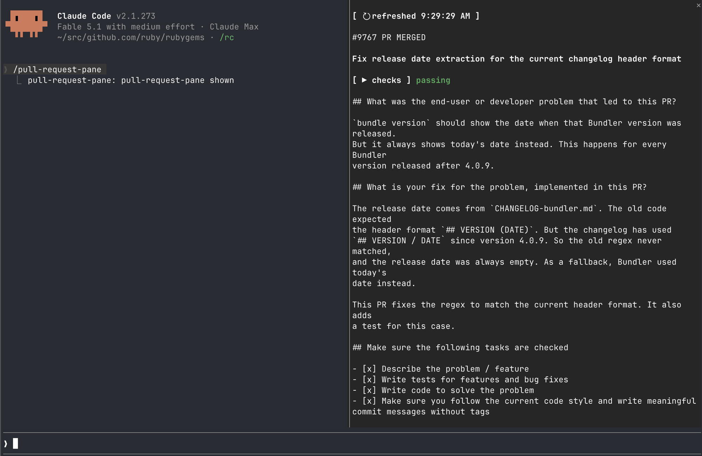

# pull-request-pane

[English](README.md)

[](https://github.com/meganemura/pull-request-pane/actions/workflows/test.yml)



pull-request-pane は、今のセッションに関係する GitHub の pull request を、transcript の横の pane に表示する Claude Code の plugin（mod）である。

- entry の title か description の上をドラッグすると、その範囲にコメントを残せる。両方のフィールドにいくつでも追加でき、entry 全体へのコメントも 1 つ追加できる。そのあと Submit を押すと、すべてを 1 つのプロンプトとして送る。
- pane が開いている間、各 pull request の checks、review decision、mergeability はタイマーで更新される。

pull request が close する issue と、transcript が触れている issue も entry として表示する。
pull request の並びと issue の並びの間には線を引き、2 つが同じ種類の 1 つの一覧に見えないようにする。

## 必要なもの

- Claude Code 2.1.273 以降。Claude Code 2.1.287 以降は mod を標準で読み込む。それより古い版では `CLAUDE_CODE_ENABLE_FUNCTION_HOOKS=1` を設定する。
- terminal のセッション、または Claude Code Desktop の Code タブ。print mode（`-p`）には pane がない。
- GitHub にログインした `gh`

## インストール

```sh
claude plugin marketplace add meganemura/pull-request-pane
claude plugin install pull-request-pane@pull-request-pane
```

`/pull-request-pane` で pane の表示と非表示を切り替える。

checkout を使って開発するときは、作業ツリーから直接 plugin を読み込む。

```sh
claude --plugin-dir /path/to/pull-request-pane/plugin
```

### Claude Code Desktop

pane は Claude Code Desktop の Code タブにも描かれる。
上の command で user スコープにインストールした plugin は、Desktop でも読み込まれる。
Desktop では `/plugin` は動かない。
アプリからインストールするには、プロンプト欄の横の + を押し、Plugins、Add marketplace の順に進んで `meganemura/pull-request-pane` を指定し、Add plugin を押す。

Desktop は `--plugin-dir` を受け取らない。
Desktop で checkout を使って開発するときは、`~/.claude/settings.json` の `env` に次を設定する。

```json
{
  "env": {
    "CLAUDE_CODE_PLUGIN_DIRS": "/path/to/pull-request-pane/plugin",
    "CLAUDE_CODE_PLUGIN_DIR_WATCH": "1"
  }
}
```

## 更新

entry の上に `↻ refreshed <time>` ボタンがある（最初の取得が終わるまでは `↻ reading…`）。
押すと、次の自動更新や 60 秒ごとの poll を待たずに、すべての entry の title、description、checks をすぐに取得し直す。
poll の予定は、ボタンを押した時点からやり直す。
review の作業中の entry（下を参照）は、この更新から守られる。
ターンや `gh ` command がきっかけの自動更新から守られるのと同じである。

## review のコメントを残す

各 entry は、まず識別子を GitHub 上のリンクとして表示する（pull request は `#<n> PR <state>`、issue は `#<n> Issue <state>`）。
ポインタを乗せると強調表示される。
そのあとに空行、太字の title、空行、checks（pull request だけ。status の語も太字）、空行、description の全文が続く。
title か description の上をドラッグすると、その範囲へのコメント欄が開く。
ドラッグ中は範囲の文字が強調表示され、離すと entry の下に `comment` フィールドが開き、その上に範囲が引用される。
コメントを入力して Enter を押すと追加される。
フィールドは消え、コメントは entry の下の一覧に `x` ボタン付きで出る。
`x` ボタンを押すとコメントを消す。
空のフィールドで Enter を押すと、コメントを付けずにその範囲を捨てる。
どちらのフィールドでも、何回でも繰り返せる。
常にある `overall` フィールドは、同じ方法で entry 全体へのコメントを 1 つ受け取る。

Submit を押すと、その entry へのすべてのコメントを 1 つのプロンプトとして送る。
プロンプトは entry を示す見出しで始まり、各コメントの上にそのコメントの対象の文字を引用し、最後に overall のコメントを置く。
Enter で追加していない文字がコメント欄に残っている間、または送るものが何もないとき、Submit は送らない。
その理由は status line に出る。

entry に review の作業（選択中の範囲、追加済みのコメント、コメント欄の未送信の文字）がある間、その entry の title と description は更新を止める。
そのため、Submit を押す前に、コメントが引用する文字が変わることはない。
checks、review decision、mergeability は、それとは関係なく 60 秒ごとの poll で更新され続ける。
これらは文字とは関係がない。

## checks、review、mergeability

各 pull request の status は、pane が開くとすぐに 1 回取得し、開いている間は 60 秒ごとに取得する。
まだ status がない pull request は `fetching checks…` と表示する。
entry の下のフッタは、取得中は `status updating…`、取得が終わると `status <time>` と表示する。
取得したあとは、`▶ checks` のトグルと、色の付いた 1 語を描く。
語は `failing`（赤）、`running`（黄）、`passing`（緑）、`no checks` のどれかである。
これで、詳しく見る必要があるかどうかが一目でわかる。
トグルを押すと詳細が出る。
まず要約の行（`✓<pass> ✗<fail> …<pending> · <review decision> · <mergeable>`）があり、そのあとに各 check を名前で並べる。
各 check は自身の結果で色が付き、run があるときはそこへのリンクになる（GitHub Actions、CircleCI など、check を作ったもの）。
リンクのある check にポインタを乗せると強調表示されるので、クリックできることがわかる。
issue には status がない。

各 entry の description は、title と status の下に全文を描く。
pane より幅の広い行は、必要なだけ画面の行に折り返す。
折り返しをまたいでも、ドラッグの位置は正しい文字に対応する。

## 保存

pane を開いたこと、または pane 自身のデータの変化は、この plugin 自身の store に保存する。
そのため、このファイルを読み込み直したとき（`--plugin-dir` で開発しているときや、エンジンが自分で行うそのほかの読み込み直し）は、`reading…` ではなく、最後にわかっている entry をすぐに表示する。
次にセッションを操作したときに、バックグラウンドの更新が追いつく。

## 状態

early access である。
function-hooks API は、Claude Code のリリースの間で予告なく変わることがある。
